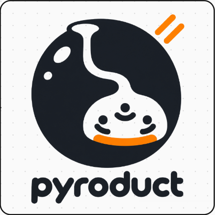

# Pyroduct



一个可运行、可测试的 MoonBit 状态机族，以两部中文哲学文本为模——《通往宁静
之路：个体道德发生论纲要》及其母本《伽达默尔与哈贝马斯真理观比较》（上海社会
科学院，2008）——外加一个过闸进化的 Agent 状态机与一个科研 Agent 协调器。

一个主体：34 位置 · 53 迁移 · 11 阶段。一个群体：20 · 44 · 9。一个社会：
13 · 28 · 8。两个主体：14 条规范规则。

## 特性

* 纸面可执行，不是转述

  每个状态、迁移、阶段都是带出处的字面数据：`gloss()` 载原文措辞，每个构造都标注
  原文直述 或 模型整理。页码不在此列——`P.xx` 只在勘察记录真记下的地方出现
  （`multi`／`group`／`society`），主体机自己的表没有页码字段。

* 一种语言，四种单位

  主体／群体／社会 在三个尺度上共享同一套「状态 + 触发 + 迁移」词汇：
  `src`（34·53·11）、`group`（20·44·9，成员配置 → 涌现，R7 回写）、`society`
  （13·28·8，生活世界 vs 系统）。`multi` 是规范面：两个主体的 R1–R14——
  体制优先、有效性主张时序、两诚区分、解蔽—遮蔽——每条规则都引论文出处。

* 只用两字定名

  位置与阶段的定名只命名结构关系——不命名别的。这条纪律由测试锁定，并由
  `render_naming_table()` 打印。

* 驱动槽与执行契约

  `Trigger::slot` 用穷尽匹配把 49 个触发归入八个槽（处境／取向／先行／行动／
  反馈／持存／共在／揭蔽）——一个未归位的触发即编译失败。`step(位置, 槽)`
  只回答 迁／守／未定／同归／无路；在 272 个位置 × 槽组合中，228 个如实回答 无路。
  机器从不编造一个动作——而且自 0.1.26 起，它连「是哪一句」也不编造：在那三处
  多条触发通向同一去处的 位置 × 槽 上，它回答 同归（去处确定，来处不点名），而不是
  从表里随手点第一条。`step_by_trigger(位置, 触发句)` 则把那句触发句当作给定的前提。

* 更新必须过闸门的 Agent

  `evolution` 把 Agent 的配置当作 `Genome`，枚举单步候选（提示／策略／记忆／
  代码），把「更好」写成 `Objective`，用宪法不变量圈起边界，并把每次
  接受／拒绝／回退连同理由记进一个只追加、可序列化的 `Ledger`。每条记录都记着它是从
  账本里哪一条长出来的，于是这本账同时是一棵树：`roots`、`children`、`depth`、
  `ancestry`、`leaves`、`height`、`lineage`——而这条世系是被检查的，不是被声称的：
  非根记录的父必须是根或一条被接收的改动，且与它恰好差一处。闸门有两档：
  手写权重，或 DoubleML 因果效应（θ̂ > 0 且 95% 下界 > 0）。主体循环
  `run_cycle` 按驱动槽驱动真实位置，把修习与开放送进同一个闸门——
  没有证据就不前进。

* 拒绝闭合的协调器

  `coordinator` 补上了状态机之外科研 Agent 需要的东西：任务与制品、依赖图上的
  规划、按置信区间（而非投票）判断的外部证据、保留被取代发现的内容记忆、
  带 IP 出处的署名，以及商谈／决策分段——交付物带修订标记、残余归属与重开
  条件。运行时可重放、可落盘。（「想」这一步仍是确定性替身，暂无 LLM。）

* 依赖隔离

  四个具名的第三方依赖，各自限于其消费者：`moonbitlang/async@0.22.7` →
  `cmd/coord`（native 落盘）与 `tools/ifacescan`／`cmd/ifacescan`（`.mbti` 漂移
  绊线，native）；`riantr/moonbit_doubleML@0.164.56` → `dmlref` /
  `causal`；`riantr/snn_mbt@0.166.2` → `snnref`（native）；`riantr/
  moonbit_static_analysis@0.4.33` → `audit`。其余包只用官方 `moonbitlang/*`。

## 你拿到什么

本模块是一个库，所以「你拿到什么」是**数据结构与报告**，不是一个跑起来的服务。
具体地说：

| 你调用 | 你拿回 | 形状 |
|---|---|---|
| `@src.step(位置, 槽)` | 五种回执之一 | `Moved` / `Held` / `Open` / `Same` / `Block` |
| `@src.step_by_trigger(位置, 触发句)` | 同样五种，但点名是哪一句 | 枚举 |
| `@multi.encounter(me, other, discourse, claim)` | 一次遭遇的判词 | `Verdict`（6 种） |
| `@src.spec_json()` | 整台机器作为一份文档 | 约 10 KB 的 JSON 字符串 |
| `@src.render_report()` / `render_mermaid()` / `render_dot()` | 人读的渲染 | `String` |
| `@evolution.evolve(genome, world, criterion, rounds)` | 一本记着被接收改动的账 | `Ledger`（一棵树） |
| `@coordinator.runtime.step(...)` | 一个可重放的检查点 | `String`（tab 分隔） |

上面每一个都是**纯函数或一个显式的数据值**。没有隐藏的全局状态，没有时钟，没有
网络：同样的输入给出同样的字节——所以 `moon test` 能对它断言，所以门禁能检查本仓
自己写下的那些话。

其上还有两个交付面：

- **CLI**——`moon run cmd/main -- <face>` 把任意一层打印成报告。37 个子命令；写错
  一个会以非零退出，而不是打印默认报告。
- **JSON 桥**——`cmd/jsoncli` 收一个 JSON 请求、回一个 JSON 回信
  `{ok, kind, rendered, faces}`。两个 agent 插件（MiniMax 的 `plugin/`、DeepSeek
  的 `.dsh/`）spawn 的就是它；这是 agent 唯一需要的面。

桥以**快照**形式分发，不是一个 checkout：`plugin/vendor/jsoncli.js` 在
`plugin/vendor/BUILD.json` 里用 SHA-256 钉住，所以在一台没有 MoonBit 工具链的机器
上，插件的回答方式不变。把 `PYRODUCT_PROJECT_DIR` 指到一个 checkout，同一个工具
改读*那棵树*，`pyroduct_gates` 也在那里跑门禁。

### 四层自检

把一台机器**描述**出来是容易的那一半。下面四层是**检查**它的——每一层都取自另一个
项目在另一种语言里解决过同一个问题。

| 层 | 它钉住什么 | 取自 |
|---|---|---|
| `@src.check_contracts()` | 回执必须**恰好**点名迁移表里那些边——说「无路」的地方得真的没有边——并在每一个「位置 × 槽」的求值点上求值 | Sismic（按契约设计） |
| `@multi.derive_chain(...)` | R1–R14 变成规则库，**优先（软）与击败（硬）分开记账**，每一次判词都有一条可机读的推导链 | 可辩逻辑 / ASPIC+ |
| `@evolution.replay_gate(...)` | 这条判词是**按哪把尺子**裁的，以及拿账本里封好的输入重裁一遍 | @metaharness/flywheel |
| `@coordinator.restore(...)` | 整台运行时的一枚内容指纹，以及一本**降级账**——每一处被迫猜测都点名 | SDYJ_Multi_Agents |

其中两层存在，是因为早先那一版**悄悄地**错了，而「悄悄」正是问题所在。协调器的
`restore` 从前会把一份坏掉的检查点解析成一台「看起来没事、其实处处都错」的运行时
——解析不了的数字变成 `0`，认不出的商谈类型变成「理论商谈」。现在它把每一处被迫
猜测都记进账本，并且**失败闭合**。进化账本从前记了**裁了什么**，却没记**用哪把尺子
裁**；而两把尺子中有一把是 DoubleML 那一档（种子决定数据，数据决定尺子），于是两次
运行可以用两把不同的尺子，而账本看上去一模一样。

结果由各自所属的面实时打印：`loop` 面打印契约核验与轨迹覆盖，`multi` 面打印推导
链，`coordinator` 面打印重放闸门与降级账。

## 怎么接进一个正在跑的 Agent

状态机不是 agent 的模拟；它是 agent **调用的一层判决**。三道接缝，按 agent 遇到它们
的顺序。

**1 · 标注行为。** agent 一有动作，调用方把观察到的话语映射到一个触发
（`@src.step_by_trigger`），读回一个回执。这个回执就是标注：`Moved` 表示这句话真的
推动了 agent，`Held` 表示它被就地吸收，`Block` 表示机器在这条路上没有出路，调用方
不许假装有。在 272 个位置 × 槽组合中，228 个如实回答 无路——这个数字就是重点。一个
说「你这一步被挡住了」的 agent，是在引用一张表，不是在即兴发挥。

**2 · 把结果反馈回来。** `@evolution` 给一份配置打分，靠的是*问机器*而不是问模型：
`evaluate(genome, opponents)` 返回四个分量——共识、稳定性、残余、成本——其中对手
是主体，回答是真实的 `@multi.encounter` 判词。所以「这份配置更好」是一条关于两个
角色相遇的报告，不是一个相似度分数。

**3 · 给自我修改上闸。** 对 agent 配置的一次改动是一个 `Candidate`（提示／策略／
记忆／代码，一次一个位点）。它要过 `judge`：

- **宪法层**——三条不变量（R10 残余 ≥ 1；R2／R14 不许宣告式口吻；R3 仍对他人敞开），
  任何分数都买不到。违者直接被拒。
- **选择层**——要么手写权重，要么一个 **DoubleML 因果效应**：只有 θ̂ > 0 *且*
  95% 下界 > 0 才收。

然后写进一本只追加的 `Ledger`，连同理由一起记下；而且——因为每条记录都记着它是
从哪条长出来的——这本账同时是一棵树，它的 `lineage` 是被检查的，不是被声称的：非根
记录的父必须是根或一条被接收的改动，且与它恰好差一处。

于是回路是：**行动 → 标注 → 打分 → 提案 → 过闸 → 记录**，而记录能活过进程
（`cmd/coord` 把一个检查点经真实磁盘 I/O 往返，并断言它回来时逐字节相同）。这里
*没有*的是模型：「想」这一步仍是确定性替身。这一层决定什么算改进、什么不许改；做
思考的模型接在它上面。

### 因果结论的前提

DoubleML 闸门是全仓唯一许下统计承诺的地方，所以它的前提写在这里，而不是留在暗处。

**实际被估计的是什么。** `@ml.dml_plr` 拟合偏线性模型 `Y = θ·T + g(X) + ε`，条件是
`E[ε | X, T] = 0`、`T = m(X) + v`，用 Neyman 正交分数与 K 折交叉拟合。它是给定协变量
`X` 时，处理 `T` 对结果 `Y` 的一个*去干扰项的*效应。

**θ̂ 要名副其实，必须成立什么。**

1. **给定 X 无未测混杂**（`E[ε | X, T] = 0`）。这正是「找齐全部干扰因素」做不到的
   那一条——干扰因素不是被估计器*发现*的，是被条件集*假定掉*的。不在 `X` 里的干扰
   项，估计器内部再多的机器学习也拿它没办法。
2. **重叠／正性**——两种处理状态必须在每个 `X` 上都出现。本仓的数据靠构造满足它
   （处理是 `X` 的连续函数加噪声），但**本仓没有实现重叠诊断**——真实部署必须自己查。
3. **正确设定或可学的干扰项** `m(X)`。交叉拟合防的是*过拟合*干扰项；它防不了一个
   从现有数据里学不出来的干扰项。
4. **定义良好的干预。** `T` 必须是一个可操作的、有连贯反事实的处理，而不是别的东西
   的代理。

**本仓怎么对它保持诚实。** 敏感性层（`@causal`，`rv = |θ̂| / max_bias`）报告一个
*未观测*的干扰项要强到什么程度才能推翻结论——它报告的是一个有限数，不是一份保证。
多重检验校正（BH／Bonferroni）之所以要加，是因为每触发一次跑一遍闸门，会把假阳性
率抬到远高于 5%。异质性（BLP）报告效应是否随协变量变化。**`causal` 包是只读的**：
它的数字进报告，不进闸门，所以没有任何诊断能悄悄改变「什么算一次被接收的改动」。

**以及诚真的边界。** 数据集是**合成的，由状态机自己生成**（`@ml.make_dataset`：
协变量取自 `freedom`、阶段序号、出度与到宁静的距离；处理由它们加上一个随机游走的
修习计数得到；真值 θ = 1.5 按构造已知）。所以本仓演示的是*估计器在已知混杂下复原
一个已知真值*——这是对估计器、以及对与 `riantr/moonbit_doubleML` 互校的正确性检查，
**不是**任何现实干预会得出同样结果的证据。真实数据带来上面那几条假设；本仓带来的是
能让你检查它们的那套机械。

## 与本仓所镜像的成熟库对比

下表每一面镜像的是**另一个语言里成熟库的语义**——刻意不镜像它的数字，也刻意不镜像
它的范围。对照上游源码实测（2026-10-30）。

| 面 | 镜像 | 上游 | 上游能做而本仓不能 | 本仓能做而上游不能 |
|---|---|---|---|---|
| `spec` | python-statemachine `io/` | JSON／YAML／SCXML → `StateChartDefinition` → 机器类；解析器与 JSON Schema 断言相等 | **从文档造出**一台机器；SCXML 合规；并行区域与历史状态；守卫、动作与回调／监听器系统；同步 + 异步双引擎；Django 集成 | 导出 **机器 → 规格**，并拒绝反向：若给出「规格 → 机器」的构造器，就等于在自己「数据即代码」的纪律之外另立一个事实源；每个构造都带出处（原文措辞 vs 模型整理） |
| `algebra` | Ragel | 把正则／状态图编译成 C、C++、Go、Rust、JS… 等语言的 *可执行* FSM；Hopcroft 最小化 | **生成代码**；以正则语言为输入；自带扫描器模式 | 读一台**已存在的**机器并报告它的代数（算子映射、主线分解、最小商）；机器始终是数据 |
| `aho` | pyahocorasick | C 实现的 Aho-Corasick 自动机：trie + 失败链 + 输出合并，dict 式访问 | 面向任意字符串的通用多模式匹配 | 在 49 条触发句上建自动机，并把它读作**回忆结构**——失败链是「退回到最长的共同过去」这一动作的算法形式 |
| `petri` | CarlAdam | Python Petri 网：不可变的（pmap／pset）标识、`enabled_transitions`、交互式模拟器 | 让你*编写*任意的网，配一个浏览器模拟器 | 把主体机读成一张网（34 个库所、53 个变迁）并证明托肯守恒；着色的边界是被声明的，不是伪造的 |
| `pathsum` | FiniteStateTransducers.jl | 半环上的加权自动机；`shortest_distance` 与 `properties` | 通用的加权自动机机械、任意半环 | **在这台机器上**跑热带最短路——通往宁静的阶梯——外加机器性质（逐触发的确定性、按设计的不无环） |
| `buchi` | Büchi／ω-自动机 | ω-自动机的接受、非空性、活性 | 通用的 ω-自动机 | 把这台机器读成 ω-自动机：经 lasso 判非空、活性潜势，以及 11 个停滞自环——10 个拒绝（结构不强制活性）、宁静自己那个被接受的停滞 |
| `dmlref`／`causal` | doubleml-for-py | 20 个估计器类（PLR、LPLR、PLPR、PLIV、IRM、IIVM、DID 家族、SSM、PQ、QTE、LPQ、APO(S)、CVAR、BLP、PolicyTree；RDD 在这份 checkout 里叫 `RDFlex`），库本身 91 个文件／约 32k 行，含测试 359 个／约 74k 行，建在 numpy／pandas／scikit-learn／scipy／statsmodels／optuna 之上 | 整个估计器族、面板数据、绘图、超参调优 | 估计器本身**零第三方依赖**（线性代数、交叉拟合、正交分数与随机数都是手写——整个 `ml` 包 1,335 行），外加与 MoonBit 移植版 `riantr/moonbit_doubleML`（22 个估计器）的*互校*——本仓拿另一个独立实现对照自己，而不是自带一个 |
| `loop`（契约） | Sismic | Python 状态图解释器／检查器：宏步／微步、挂在状态与迁移上的 before／after／always 契约、轨迹覆盖 | 从 YAML／JSON 定义**造出并运行**任意状态图；用显式 priority 排解歧义 | 检查**这台机器**的回执对**这张表**——回执必须恰好点名表里那些边——在每一个「位置 × 槽」的求值点上求值，并报出迁移表里**从未被走过**的行 |
| `multi`（推导链） | 可辩逻辑 / ASPIC+ | 严格规则与可辩规则之分、显式击败、规则间的优先序、带接受集的论证语义 | 通用规则库与证明搜索 | R1–R14 变成规则库，**优先（软）与击败（硬）分开记账**——信仰商谈那个例外是**击败**，不是排序，因为优先序表达不了「除非」——每一次判词一条推导链，并与遭遇层互校 |
| `evolution`（闸门审计） | @metaharness/flywheel | 一代代候选、晋升闸门、谱系 bundle、闸门指纹，以及「信任重跑的闸门，而不是日志里那句判决」这条规矩 | 持久化的 bundle、任意策略字符串、e-process 序列检验 | **尺子**（权重，或 DoubleML 的配置*连同种子*）逐条判词钉住，并拿封好的输入**重跑闸门**——尺子动过、判词对不上、尺子没记，都失败闭合 |
| `coordinator`（回放） | SDYJ_Multi_Agents | record-and-replay：按哈希键缓存 LLM 与工具的响应、按 prompt 哈希匹配、崩溃时写下部分状态、从检查点续跑 | 跨进程缓存 LLM 响应；一个人工复核节点 | 整台运行时的**内容指纹**、把同一份计划跑两遍的**重放闸门**，以及一本**降级账**——恢复时每一处被迫猜测都点名——坏掉的检查点失败闭合，而不是恢复成一台「看着合理但值全错」的运行时 |

两处不对称值得直说。第一，**本仓的 `ml` 是一个估计器（PLR）加一次互校**，不是
doubleml-for-py 的替代品——那个 22 个估计器的移植版是本仓消费的一个独立包。第二，
被镜像的库是*通用*的，本仓不是：它们把你的机器当输入、把机械还给你，而本仓的各个
面是一台特定机器的只读视图。本仓加上去的是出处层、「缺口如实报告而不填补」的纪律，
以及把 agent 的自我修改关在宪法边界内的那道闸。

## 术语表

每个构造都带一个两字中文定名、一个英文枚举标识符，以及它所命名的原文。下表
是全部词汇的英文转译，覆盖三个尺度（主体／群体／社会）与规范层。

**English** 列是*代码标识符*——你在 MoonBit 里写的那个枚举变体，也是已发布
接口暴露的东西。它是冻结的：改 `Slot::Occasion` 的名字会弄坏每一个把它传给
`step` 的调用方。*英文读法*是下面「英文对照层」那一节的 `en_*` 系列，散文里
该用读法。两者允许不同，因为它们回答的不是同一个问题：标识符给构造在源码里
的名字，读法给读英文的人的名字。

凡标识符的字面英文词站不住的，读法换掉它，理由记在 `src/en.mbt` 里：

* 处境 `Occasion` → **Situation**——occasion 是某种特定场合，处境是人所处的
  境况。
* 修习 `Discipline` → **Cultivation**——修养是 cultivation；"discipline" 得留给
  群体的规训 `Disciplined`，那是另一回事：把群体连同成员一起束缚、把自由收起。
* 自缚 `Binding` → **Self-binding**——「自」正是要害：缚的是自己，不是迁移表。
* 交织 `Weaving` → **Interweaving**——编织可以是一方的，交织必是互相的，且与
  `Interweave` 那条触发句同源。
* 无路 `Block` → **No-way**——是没有路，不是没有边界；界域 *frontier* 是本模型的
  核心概念，用 edge 会撞车。
* 先行 `Antecedent` → **Antecedent**——保留。原来作 `Anticipation`，那说的是槽
  *引出的*心态，不是这个结构关系本身。

另有两处也是有意不同、但标识符本身没错：无筹作 `NoFuture` / `Aimless`，因为标识符
说的是两字定名、读法说的是原文浑噩；同归作 `Same` / `Converge`，因为 `Same` 是
代码里与 `Moved`、`Held` 并列的那个名字，而实际发生的是多条触发句向同一去处收敛。

还有一对看着像疏漏、其实不是：反顾作阶段是 `Recollection`、作位置是 `Reflection`。
和立位（`Natural` / `Standing`）一样，两者的**原文本来就不同**——阶段的原文是反思，
位置的原文是审视——所以原文自己就区分了它们。**定名与原文措辞相同**时，一个英文词
才对；**原文自己能区分**时，英文也该区分。

### 阶段——主体（11）

| 定名 | English | 原文 |
|---|---|---|
| 立位 | Natural | 本然 |
| 自决 | Release | 自由的发生 |
| 自成 | Becoming | 自身与拣选 |
| 遭遇 | Otherness | 与他者相遇 |
| 归责 | Bondage | 恶感·耻感·罪感·自缚 |
| 受创 | Anguish | 痛苦与失落 |
| 奠基 | Idolatry | 偶像与根基 |
| 献身 | Glory | 崇高·激情·荣誉·敬畏 |
| 反顾 | Recollection | 反思 |
| 范导 | Upbringing | 修养之路 |
| 安位 | Serenity | 宁静 |

### 位置——主体（34）

| 定名 | English | 原文 |
|---|---|---|
| 无忆 | NoPast | 失忆 |
| 无筹 | NoFuture | 浑噩 |
| 立位 | Standing | 站立 |
| 自由 | Freedom | 自由 |
| 紧迫 | Urgency | 紧迫感 |
| 疏离 | Alienation | 疏离感 |
| 空虚 | Emptiness | 空虚 |
| 忙碌 | Busyness | 忙碌 |
| 自身 | Selfhood | 独立的自身 |
| 交织 | Weaving | 图画 |
| 择取 | Choosing | 拣选 |
| 相遇 | Encounter | 相遇 |
| 敞开 | Opening | 敞开 |
| 受挫 | Evil | 恶感 |
| 自归 | Shame | 耻感 |
| 失权 | Guilt | 罪感 |
| 自缚 | Binding | 束缚 |
| 隐没 | Secret | 秘密 |
| 痛苦 | Suffering | 痛苦 |
| 沉落 | Loss | 失落 |
| 投射 | Idol | 偶像 |
| 立序 | Ordered | 秩序 |
| 崇奉 | Sublime | 崇高感 |
| 激情 | Passion | 激情 |
| 受赏 | Honor | 荣誉 |
| 畏怖 | Awe | 敬畏 |
| 惯习 | Habit | 习惯 |
| 反顾 | Reflection | 审视 |
| 眩晕 | Dizziness | 眩晕 |
| 平衡 | Harmony | 和谐 |
| 范型 | Model | 榜样 |
| 图绘 | Marking | 标记 |
| 修习 | Discipline | 修养 |
| 宁静 | Tranquility | 宁静 |

### 驱动槽（8）与 49 个触发

| English | 定名 | 数 | Triggers |
|---|---|---|---|
| Occasion | 处境 | 6 | TakeStand, FeelFinitude, FeelBoundlessness, FuseFeelings, MustBeBusy, ColdHard |
| Orientation | 取向 | 6 | ChooseMoreLasting, Complexify, SeekMoreJoy, SeekBalance, SeekGoal, TakeModel |
| Antecedent | 先行 | 4 | TouchFuture, TryMethods, Approximate, WaitNext |
| Act | 行动 | 9 | ActInFreedom, BindSelf, Avoid, CutPast, SummonIdol, MarkGoodBad, RedrawMap, Endure, RemoveReefs |
| Feedback | 反馈 | 8 | Sting, BlameSelf, EnactOrder, AbsorbGlory, Reward, Dread, WidenFrontier, Ascend |
| Hold | 持存 | 8 | KeepContinuity, Deposit, TurnToResidue, Interweave, Surprise, Doubt, Linger, Habituate |
| CoBeing | 共在 | 3 | MeetOther, GoodFaith, OpenArms |
| Unveil | 揭蔽 | 5 | AttributeSelf, FillEmptiness, CoolDown, DoubtOneself, ReopenByHorizon |

### 执行契约（五种结果）

迁 Moved · 守 Held · 未定 Undecided · 同归 Same · 无路 No-way

槽粒度下，多条触发句从同一位置通向同一目标时，机器回「同归」：去处已定，
但**不点名是哪一句**——因为认不出来，所以不编。要知道是哪一句，用 `step_by_trigger`。

### 群体——阶段（9）

| 定名 | English | 读法 |
|---|---|---|
| 聚散 | Gathering | 众人只是一群，彼此尚无关联；群体还不是主体 |
| 成体 | Bodied | 共同的语言与商谈给群体一个身体 |
| 立序 | Ordering | 由理由或传统立起共同规矩 |
| 分歧 | Diverging | 差异被承认、体制相左、界域关闭 |
| 失度 | Excess | 第三者交给绝对者——投射、独白 |
| 自缚 | SelfBound | 群体把自己与成员一起束缚；隐成了不许问 |
| 受损 | Impaired | 集体的创伤与离散 |
| 修习 | Cultivating | 复归、忍受、扩界 |
| 宁定 | Resting | 每一对成员都双诚俱足；不再绝对化任何结论 |

### 群体——状态（20）

| 定名 | English | 阶段 |
|---|---|---|
| 散在 | Scattered | 聚散 |
| 趋同 | Converging | 聚散 |
| 共语 | CommonTongue | 成体 |
| 商谈 | Discourse | 成体 |
| 规范 | Normed | 立序 |
| 共识 | Consensus | 立序 |
| 歧见 | Dissensus | 分歧 |
| 对峙 | Confronting | 分歧 |
| 割据 | Partitioned | 分歧 |
| 投射 | Projected | 失度 |
| 独白 | Monologic | 失度 |
| 规训 | Disciplined | 自缚 |
| 遮蔽 | Concealed | 自缚 |
| 创伤 | Wounded | 受损 |
| 离散 | Dispersed | 受损 |
| 复归 | Returning | 修习 |
| 修习 | Practicing | 修习 |
| 扩界 | Widening | 修习 |
| 相契 | Attuned | 宁定 |
| 宁定 | Settled | 宁定 |

群体触发（22）：Appear, Attention, SharedMedium, RaiseClaims, NormFromTradition,
NormFromReason, Agree, Differ, Clash, CloseHorizon, Absolutize, OneVoice, Bind,
Suppress, Reopen, BreakUp, TurnBack, RemoveReefs, Widen, MutualCheng, Settle,
Reenter。

### 社会——阶段（8）

社会机没有英文对照层，这里的 English 就是代码标识符本身。它的阶段取**理论术语**、
状态取**结构位置**，所以有四对故意不同、而每个词都贴合它所指：缺口作阶段是
`Aporia`（化解不了的僵局）、作位置是 `Gap`；系统作阶段是 `Instrument`
（工具理性那一层）、作位置是 `System`；规范作阶段是 `Rule`、作位置是 `Norm`；
殖民作阶段是 `Domination`（支配关系）、作位置是 `Colony`。商谈是唯一的例外，
也已改正：阶段原作 `Speech`，那是「言语」，既不合商谈作为**受验程序**的特性
（哈贝马斯比作洗衣机），又和相邻的语言阶段 `Language` 相撞；现读 `Discourse`，
与它所包含的商谈位置同名。

| 定名 | English | 读法 |
|---|---|---|
| 生活 | Life | 以语言组织的生活世界 |
| 语言 | Language | 超主体性（伽达默尔）对 主体间性（哈贝马斯） |
| 商谈 | Discourse | 主张被提出、过滤、辩护、转为共识 |
| 规范 | Rule | 实践商谈立起的规范贴着「过去时」标签 |
| 缺口 | Aporia | 第三者在现实中不可能——乌托邦的命运 |
| 系统 | Instrument | 以金钱与权力为中介的系统 |
| 殖民 | Domination | 对生活世界的内在殖民化；被扭曲的交往 |
| 复建 | Rebuild | 重建被扭曲的交往领域 |

### 社会——状态（13）

| 定名 | English | 阶段 |
|---|---|---|
| 世界 | World | 生活 |
| 超体 | Suprasubjective | 语言 |
| 间性 | Intersubjective | 语言 |
| 主张 | Claim | 商谈 |
| 商谈 | Discourse | 商谈 |
| 辩护 | Justification | 商谈 |
| 共识 | Consensus | 商谈 |
| 规范 | Norm | 规范 |
| 缺口 | Gap | 缺口 |
| 系统 | System | 系统 |
| 殖民 | Colony | 殖民 |
| 扭曲 | Distortion | 殖民 |
| 重建 | Reconstruction | 复建 |

社会触发（18）：SpeakLanguage, BuildIntersubjective, RaiseClaims, EnterDiscourse,
Filter, Justify, Subsume, Store, EnactNorm, LabelPast, DemandThird, Serve,
Expand, Colonize, Distort, Hinder, Reconstruct, Circulate。

### 真理体制（5）· 商谈类型（4）· 有效性主张（4）

| 定名 | English | 读法 |
|---|---|---|
| 内在秩序 | Immanent | 真理是内在于世界的永恒秩序（古埃及） |
| 逻各斯 | Logos | 真理是永恒的言说，靠理性灵魂保障（古希腊） |
| 超主体性 | SuperSubjective | 伽达默尔：理解与语言是超主体事件 |
| 主体间性 | InterSubjective | 哈贝马斯：真理即主体间有效性主张，横纵成网 |
| 诚然 | ChengRan | 作者方案：诚然的诠释学，统于自性内照 |

| 定名 | English |
|---|---|
| 理论商谈 | Theoretical |
| 实践商谈 | Practical |
| 表达性商谈 | Aesthetic |
| 信仰商谈 | Faith |

| 定名 | English | 主张 |
|---|---|---|
| 真实性 | Truthfulness | 命题真实性——客观世界 |
| 正当性 | Legitimacy | 规范正确性——社会世界 |
| 他之诚 | Authenticity | 言语内容之契合（本真性） |
| 己之诚 | Sincerity | 行为与意向之契合（真诚性） |

主张时序：事前 Before · 事中 During · 事后 After。

### 规范规则 R1–R14

| 编号 | 定名 | English |
|---|---|---|
| R1 | 体制优先 | Regime precedence |
| R2 | 不独断 | No dogmatism |
| R3 | 解蔽—遮蔽 | Unconcealment–concealment |
| R4 | 有效性时序 | Validity-claim timing |
| R5 | 两诚区分 | Two-sincerity distinction |
| R6 | 弃符合论、存方法 | Drop correspondence, keep method |
| R7 | 构成性 | Constitutivity |
| R8 | 第三者 | The third party |
| R9 | 商谈类型 | Discourse types |
| R10 | 谬误残余 | Error residue |
| R11 | 不可闭合 | Never closed |
| R12 | 诚然相契 | ChengRan resonance |
| R13 | 横检纵共 | Horizontal review, vertical commonality |
| R14 | 共识即建议 | Consensus as suggestion |

### 包

`src`（主体机）· `multi`（规范规则）· `group`（群体涌现）· `society`（双层
社会模型）· `ml`（自研 DoubleML）· `evolution`（Agent 状态机）· `coordinator`
（科研 Agent 运行时）· `dmlref`（外部互校）· `causal`（因果诊断）· `audit`
（三鉴静态审计，0.1.28 起扩到群体机与社会机，另有 `fleet`／`mutants` 两个面
——变异网用 18 处故意的破坏证明「0 条发现」不是「什么都看不见」）· `snnref`
（脉冲沉淀实验）· 另有 `mbti` 面：用同一套三鉴审本仓库**自己的**
`pkg.generated.mbti`（重复签名／畸形行／未知类型引用）。该面扫的是内嵌快照，
好让它能在 wasm 下跑；另有一条 native 绊线证明快照仍与磁盘上的文件相等。

### 纪律用语

原文直述 *verbatim from the source* · 模型整理 *model reconstruction* · 两诚
*two sincerities* · 解蔽—遮蔽 *unconcealment–concealment* · 没有证据就不前进
*no evidence, no advance* · 双诚之比 *two-sincerity ratio* · 同判·不重裁
*same verdict, not re-adjudicated* · 三鉴 *three mirrors (structure / type /
behavior)* · 往返一致 *round-trips identically*。

### 英文对照层

每个构造都在中文原文层旁边带一份英文对照：`SubjectState::en_label` /
`en_gloss`、`Slot::en_designation` / `en_gloss`、`Phase::en_label`、
`Trigger::en_label`、`Outcome::en_label`，以及 `GroupState::en_designation` /
`en_gloss` 与 `GroupPhase::en_label`。

两层刻意不对称。`label()` 与 `gloss()` 是原文所云的记录，一律不译；`en_*`
系列是给读不了中文的使用方看的读法。两者不一致时，按定义以 `label()` 为准。

读法是逐个构造、按它「实际是什么」挑出来的，不是把中文词直译过去。同一个定名
在哪儿出现都用同一个英文词：修习在主体机的位置、群体机的阶段、群体机的位置三处
都是 `Cultivation`——也正是这一点逼出规训必须留着 `Disciplined`、修习必须让出
`Discipline`。阶段和别的构造一样只用一个词命名，因为它原先带的那句短语
（"The Arising of Freedom"）会在某个位置加入该阶段的那一刻悄悄过期，而阶段装
了哪些位置是成员表的活。

这一层今天还没有任何分析面渲染它；它是给需要用英文读这台机器的表层准备的导出
词汇表。

英文层不参与状态机。那里写错只会把一条迁移叫错名字，不会凭空造出一条。
`src/en_test.mbt` 断言的正是使用方真正在意的性质——每条英文串都是 ASCII
（不会混进中文），且与它旁边的原文串不同——而不是相信 match 写对了就没事。

## 快速开始

添加模块，然后跑测试套件：

```
moon add riantr/pyroduct
moon test             # Total tests: 247, passed: 247, failed: 0.
```

在本仓库里，每一层都打印一份报告：

```
moon run cmd/main -- report        # 主体状态机
moon run cmd/main -- slots         # 驱动槽：49 个触发 → 8 个槽
moon run cmd/main -- multi         # 规范规则 R1–R14 + 场景
moon run cmd/main -- group         # 群体状态机
moon run cmd/main -- society       # 双层次社会交往模型
moon run cmd/main -- evolution     # 变异／适应度／闸门／持久化／遗传
moon run cmd/main -- cycle         # 主体循环：位置 × 驱动槽 × 因果反馈
moon run cmd/main -- coordinator   # 科研 Agent 协调器
moon run --target native cmd/coord # 真实落盘：检查点往返一致
```

## 示例

```moonbit nocheck
// 主体：位置、主线、驱动槽、执行契约
let states : Array[@src.SubjectState] = @src.all_states()      // 34 个
let ok     : Bool = @src.reachable(@src.initial(), @src.terminal())
let moved  : @src.Outcome = @src.step(@src.Standing, @src.Occasion) // 迁

// 两个主体的一次遭遇：体制、两诚、有效性主张的时序都参与裁决
let me    = @multi.subject(1, @multi.rendezvous(), @multi.InterSubjective, 70, 70, 9)
let other = @multi.subject(2, @multi.rendezvous(), @multi.ChengRan, 80, 80, 9)
let claim : @multi.ValidityClaim = { kind: @multi.Truthfulness, phase: @multi.During }
let out   = @multi.encounter(me, other, @multi.Theoretical, claim)

// 社会：两条不变量由测试锁定
let never_closes : Bool = @society.no_final_closure()

// Agent 状态机：枚举候选 → 过闸 → 只追加记账
let agent  = @evolution.default_agent()
let ledger = @evolution.evolve(agent, @evolution.default_world(),
                               @evolution.Weighted(@evolution.truth_objective()), 3)

// 协调器：跑一段示例研究，检查点写下 / 读回
let rt   = @coordinator.new_runtime()
ignore(rt.step(@coordinator.demo_tasks(), @coordinator.demo_questions(),
               @coordinator.demo_workers(), @coordinator.demo_datasets(),
               @coordinator.demo_world(), @coordinator.demo_parent(),
               @coordinator.demo_candidate()))
let restored = @coordinator.restore(rt.checkpoint())
let same : Bool = restored.round_trips()
```

## 门禁与漂移检测

基线是 `moon check`、`moon fmt --check`、`moon test`（wasm 247 个测试），
外加两个只跑 native 的包（`snnref`、`tools/ifacescan`）。其上还有六个检测器——
因为**测试全绿并不说明写在文档里的那句话还对**：

| 检测器 | 抓什么 |
|---|---|
| `python tools/validate_dependencies.py` | `architecture/*.dot` 里画了、代码里没有的依赖边；以及代码有、图里漏的边；顺带查每个 DOT 的 `model-version` 头是否与 `moon.mod` 一致 |
| `python tools/validate_resolved_deps.py` | `moon.mod` 里的 pin 解析不出它写明的那个版本——`moon update` 只刷 registry index，所以构建里没有别的东西会发现 pin 漂了 |
| `python tools/validate_cli_faces.py` | 桥的 `faces()`、CLI 的 `match` 分支、CLI 的用法头、CLI 错误消息里发布的那个数，四者对不上；它抓到过一个 CLI 能派发、桥却不认识的面 |
| `python tools/validate_pin_copies.py` | 树里某个 `package@version` 字面量不再等于它复制的那个 pin——两份 README、`AGENTS.md`、架构图、包 doc 注释、插件面目录与两份 skill 副本 |
| `python tools/validate_readme_facts.py` | 两份 README 里关于状态／迁移／阶段／触发／槽的数字与源码表对不上；以及 wasm 测试数自相矛盾或与代码对不上——已发布的 0.1.31 一处写 205、另一处写 209，而这个检测器当时全绿，因为它只数模型事实 |
| `node plugin/tools/validate-plugin.mjs` | 插件漂移：面数、测试数、模型事实、页码出处，与面向 agent 的描述对不上 |

每一个都是因为某次具体漂移没被发现才写的——图里的一条假边、工具描述里一个过期的
测试数。它们跑在 `gate.yml`（每次 push 与 PR），发版前在 `publish.yml` 再跑一遍。

## 被谁使用

- `cmd/main` — 上面每一层的报告入口：`report` / `slots` / `loop` / `multi` /
  `group` / `society` / `evolution` / `cycle` / `coordinator`，
  `dmlref` / `causal` / `audit` / `fleet` / `mutants` / `mbti`，外加
  `mermaid` / `dot` / `genesis` / `course` / `naming` / `principle` / `intuition`，
  五条分析面 `pathsum` / `algebra` / `petri` / `aho` / `buchi`，以及呈现层的 `all`。
- `cmd/coord` — 一个 native 二进制，运行协调器并把其检查点经真实磁盘 I/O
  往返（`.openseek/`，gitignored）。
- `cmd/jsoncli` — 两个 agent 插件 spawn 的 JSON 桥（31 个面）。

## 出处

- 源文本：任勇祥《伽达默尔与哈贝马斯真理观比较》（上海社会科学院，2008）及其
  附录《通往宁静之路：个体道德发生论纲要》。模型中的每个构造都标注了该文的
  章／节／页，并对 原文直述 与 模型整理 做了明确区分。
- License: MIT（见 `LICENSE`）。
